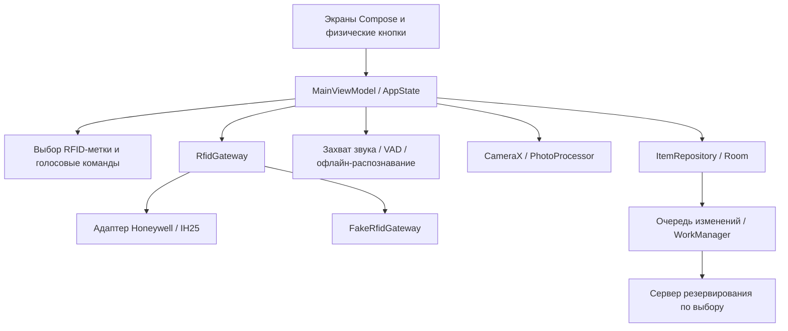
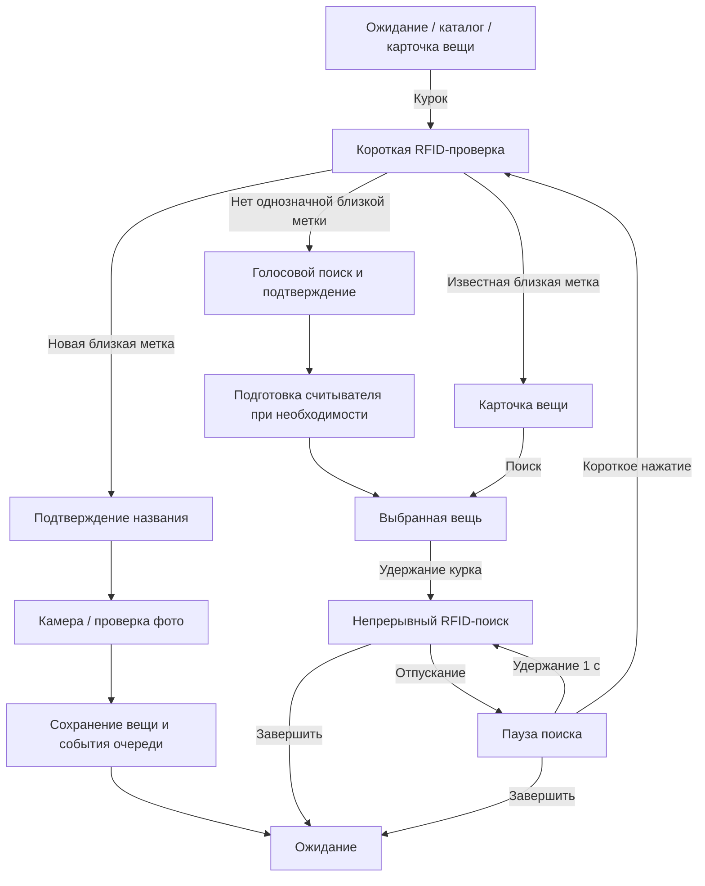
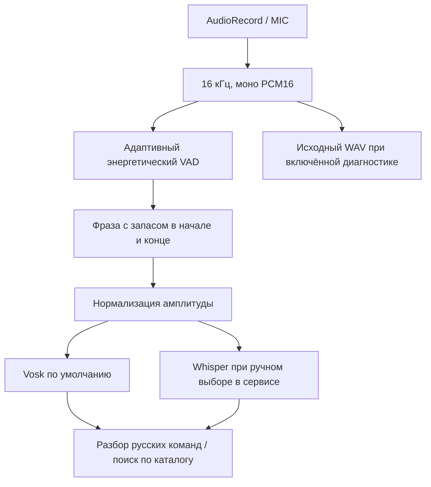

# Архитектура RFIDHunter

[English version](ARCHITECTURE.md) · [Обзор](README.RU.md)

RFIDHunter хранит каталог вещей на Android-телефоне и помогает находить вещи с помощью считывателя Honeywell IH25. Распознавание речи, фотографии и работа с каталогом выполняются локально; отдельный сервер может хранить резервную копию. Исходный целевой телефон — Huawei nova 3 с Android 9.

## Компоненты и состояние

`MainViewModel` хранит состояние сценария в потоке `AppState`. Compose отображает состояние и передаёт события; доменные правила отвечают за выбор метки, сопоставление названий, индикацию поиска, жесты курка и бездействие. Приложение владеет одним gateway, общим с `RfidForegroundService`: сервис и Activity используют одно соединение со считывателем.

Вариант `hardware` реализует `RfidGateway` через SDK производителя, а `mock` подставляет `FakeRfidGateway`. AAR Honeywell подключается локально. CameraX, захват звука и Room остаются настоящими платформенными компонентами и в mock-сборке.

Основные переходы:

При явном голосовом добавлении без заранее прочитанного EPC после проверки фото открывается `WaitForNewTag`. Замена метки сохраняет прежнюю связь, пока приложение не примет подходящую свободную метку. Переименование и замена фото обновляют существующую вещь; удаление требует подтверждения. Выбор карточки каталога открывает карточку управления вещью.

## Выбор метки и поиск

Первичное чтение работает на мощности **5 dBm в течение 850 мс**. `RfidDecisionEngine` объединяет повторы EPC без учёта регистра, сохраняет лучший допустимый RSSI и число наблюдений. Единственный кандидат должен иметь RSSI не ниже **−48 dBm**. При нескольких кандидатах лидер также должен опережать второго по силе на **8 dB**; отсутствие надёжных измерений переводит сценарий к голосовому поиску. Число наблюдений сохраняется для диагностики, минимального порога по числу чтений нет.

Непрерывный поиск отбирает наблюдения нужного EPC и работает на фиксированных **30 dBm**, пока нажат курок. Обновление экрана не перезапускает inventory. `SearchSignalTracker` экспоненциально сглаживает RSSI с коэффициентом **0,24** и сбрасывает значение через **900 мс** без допустимых наблюдений. View model обновляет индикацию каждые **50 мс**.

`SearchSignalPolicy` переводит **−82…−42 dBm** в шкалу сигнала. Любая обнаруженная целевая метка даёт небольшой звуковой отклик; при отсутствии или недопустимом RSSI стрелка возвращается к нулю и остаётся самый медленный фоновый ритм. Интервал щелчков меняется от **1100 до 85 мс**, степень **0,55** делает изменения слабого сигнала слышимыми. Эти настройки управляют обратной связью и не измеряют расстояние.

Отпускание курка ставит inventory на паузу. Короткое нажатие в паузе запускает новую контекстную проверку; удержание **1000 мс** возобновляет поиск во время того же нажатия. Завершение останавливает чтение и возвращает `Idle`.

## Подключение считывателя и жизненный цикл Android

Общий сценарий подготовки сканирует BLE **5 с**, сначала пробует сохранённый адрес, затем обнаруженные устройства, похожие на Honeywell, по убыванию RSSI. Сохранённый адрес остаётся кандидатом, даже если сканирование его не показало. Подключение и подготовка считывателя имеют таймаут готовности **30 с**; неудачная попытка повторяется через **5 с**, пока разрешено автоматическое подключение. На этапе обнаружения SDK auto-reconnect отключён, чтобы два механизма подключения не конкурировали; после готовности он включается.

Выбранная вещь ожидает в `ReaderPreparation` до `readerReady`; готовность открывает `SearchTarget` без запуска чтения. Неожиданный обрыв также запускает восстановление с главного экрана. Блокирующие команды inventory выполняются через `Dispatchers.IO`.

- **Обычный режим:** автоматическое подключение работает, пока Activity видна и экран включён. Диалоги разрешений лишь приостанавливают Activity и сохраняют соединение; уход из приложения или выключение экрана останавливает inventory и отключает считыватель.
- **Режим киоска:** foreground service сохраняет работу считывателя в фоне и обрабатывает пробуждение курком. Возврату в приложение помогают wake lock, уведомления, отдельная Activity пробуждения и необязательный overlay. Если `MainActivity` уже активна, экран пробуждения не показывается. Сам режим приложения не настраивает управление Android device owner.

Android 12+ использует разрешения Bluetooth для устройств поблизости с `neverForLocation`; Android 9–11 требует разрешение геолокации для BLE-сканирования. Поведение на экране блокировки и ограничения энергосбережения производителя проверяются на устройстве.

## Захват звука и офлайн-распознавание

Один `AudioCaptureSession` открывает микрофон через `MediaRecorder.AudioSource.MIC`. Это обходит DSP-тракт голосового ввода производителя, который на Huawei может возвращать непригодный PCM. Полученные буферы разбираются на кадры по **20 мс** независимо от размера платформенного буфера. Callback готовности срабатывает после первого обработанного кадра; калибровка шума продолжается внутри детектора. Запись завершается после тихого хвоста VAD либо по лимиту **10 с** реального времени.

`AdaptiveVoiceActivityDetector` измеряет среднеквадратичный уровень кадра в dBFS — относительно максимального уровня PCM. Начальная калибровка собирает **300 мс** кадров выше −100 dBFS; оценка шума использует нижний **20-й процентиль** истории длиной до **2 с**. До начала речи тихие кадры обновляют эту оценку. Пороги речи:

| Решение | Порог / время |
|---|---|
| Начало речи | `max(−42 dBFS, фон + 10 dB)` в течение 180 мс |
| Продолжение речи | `max(−48 dBFS, фон + 4 dB)` |
| Завершение записи | 1100 мс ниже порога продолжения |
| Возобновление после паузы | После 250 мс тишины нужны 40 мс новой активности |
| Запас границ фразы | 280 мс до начала; 160 мс после последнего речевого кадра |

Разные пороги начала и продолжения сохраняют более тихую речь после её начала. Подтверждение начала отсекает короткие щелчки, а запас перед началом сохраняет первый слог. Границы фразы ограничены доступной записью. Если речи нет, распознавание пропускается, но исходную запись можно сохранить для анализа.

После обрезки тихий звук усиливается до пика **16000** с ограничением усиления **16×**; звук с пиком от 16000 остаётся прежним. Нормализация выполняется после детекции и не меняет оценку шумового фона.

**По умолчанию используется Vosk**, который подготавливается при запуске приложения. Настроенная модель копируется из сформированных assets в приватное хранилище. Whisper.cpp `base q5_1` доступен через JNI после ручного выбора в сервисном экране; автоматического переключения между движками нет. Оба используют один тракт захвата. Нативному Whisper нужны локальные исходники `third_party/whisper.cpp` с тегом `v1.9.2`, NDK `26.3.11579264`, CMake `3.22.1` и `arm64-v8a`. Без пригодного NDK Gradle отключает нативную цель, Vosk остаётся доступным.

`VoiceDiagnosticStore` по выбору сохраняет **исходные, необрезанные и ненормализованные** моно PCM16 WAV в приватном каталоге `voice-diagnostics/`. Сервисный экран позволяет повторно распознать файл выбранным движком. `scripts/vad_reference.py` содержит эталонную реализацию детектора на Python, а `scripts/test_vad_reference.py` проверяет тишину, короткие и длинные фразы, одиночные щелчки и настройку тихого хвоста. `scripts/analyze_voice_wav.py` экспортирует уровни по окнам и строит график с заданным фиксированным порогом; этот график не отображает адаптивные пороги и границы фразы детектора.

Русские команды допускают название вещи без префикса либо явную команду поиска или добавления. Сопоставление с каталогом объединяет нормализацию текста, упрощённые основы слов, расстояние редактирования и согласные слова. Неточное совпадение требует подтверждения; близкие по оценке неточные кандидаты отклоняются, чтобы порядок записей в базе не определял выбор вещи.

## Камера, касания и обратная связь

CameraX делает снимок по любой кнопке громкости. Запрос привязан к текущему контексту камеры: занятая камера отклоняет повторный запрос, уход с экрана отменяет запрос, а запоздалый результат не открывает проверку фото в другом сценарии. Подтверждение снимка следует за принятым запросом. Экран проверки предлагает переделать или сохранить фото.

Крупные кнопки используют `resilientButtonInput`: жест закреплён за первым пальцем, смещение не отменяет действие, дополнительные пальцы не запускают новое действие, повторное срабатывание блокируется на **500 мс**. У карточек каталога отдельный обработчик: он отменяет выбор при прокрутке или мультитаче, чтобы непрерывный каталог `LazyColumn` нормально прокручивался. Громкость+ перемещает вверх, Громкость− — вниз.

После смены логического экрана касания блокируются на **600 мс**. Ключ экрана не учитывает текущий RSSI и прогресс голоса, поэтому обычные обновления не блокируют ввод заново. Переходы `AnimatedContent` сохраняют эту логическую идентичность. Цвета, типографика и общие размеры находятся в `ui/theme`, повторно используемые элементы — в `ui/components`, тела экранов — в `ui/screens`.

Индикатор сигнала и синтезируемые щелчки дают обратную связь при поиске. `OfflinePromptPlayer` воспроизводит необязательные заранее записанные файлы из `assets/voice`; без файла на экране остаётся текст. Сетевой синтез речи во время работы не используется. Сообщения очищаются при переходах между сценариями, а статусный баннер поддерживает вежливые accessibility-объявления через live region. Через **час** бездействия приложение возвращается в `Idle`, позволяя активному сохранению фото завершиться.

## Хранение и резервная копия

Схема Room версии **3** содержит `items` и `sync_outbox`. Вещь хранит EPC прямо в записи, постоянный `syncId`, название, нормализованное название, путь к фото и время изменений. Фотографии находятся в приватных файлах. Миграции сохраняют существующие вещи и создают ожидающие события резервирования; миграция 2→3 удаляет конкретные старые демонстрационные записи.

`ItemRepository` фиксирует изменение вещи и событие очереди одной транзакцией Room, затем планирует синхронизацию. Ожидающие изменения одной вещи уплотняются. Локальное удаление убирает вещь и добавляет событие `DELETE`. Единственный WorkManager worker сначала загружает фотографии по SHA-256, затем отправляет идемпотентные события; восстановление сохраняет объекты с ожидающими локальными событиями. Android Keystore предоставляет ключ ECDSA P-256 для подписи запросов.

Отдельный сервер FastAPI/SQLite поддерживает регистрацию, загрузку и восстановление каталога на другом телефоне. Порядок событий, аутентификация, конфликты и развёртывание описаны в [BACKUP_SYNC.md](BACKUP_SYNC.md) и [руководстве сервера](server/README.RU.md).
