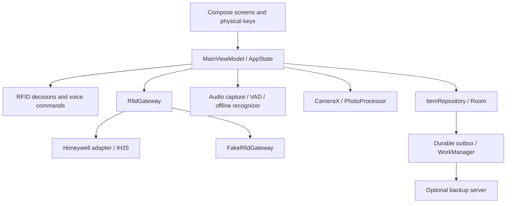
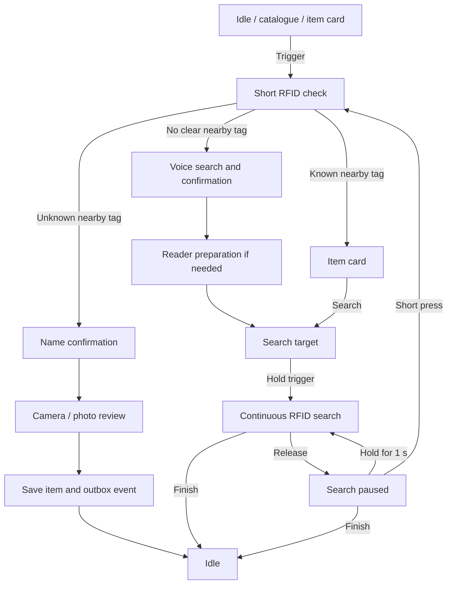
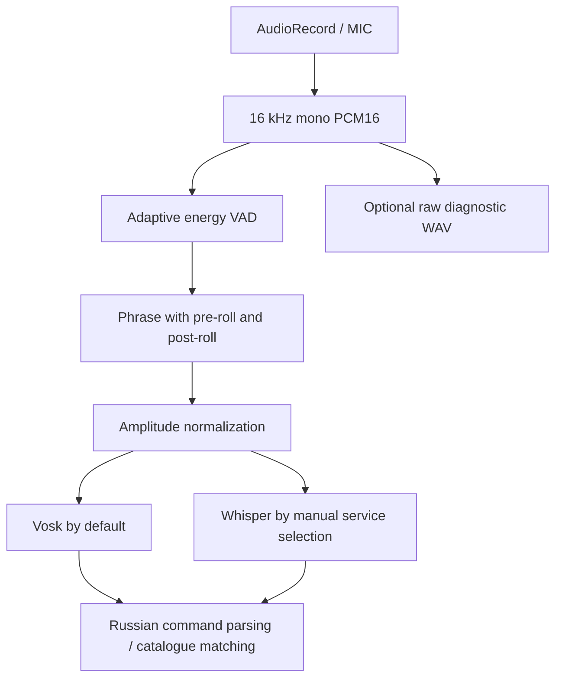

# RFIDHunter architecture

[Русская версия](ARCHITECTURE.RU.md) · [Overview](README.md)

RFIDHunter keeps an item catalogue on an Android phone and uses a Honeywell IH25 reader to locate tagged belongings. Voice recognition, photographs and catalogue operations work locally; an optional server stores a backup. The original target handset is Huawei nova 3 running Android 9.

## Components and state

`MainViewModel` owns the workflow as an `AppState` flow. Compose renders states and sends events; domain policies handle RFID selection, catalogue matching, search feedback, trigger timing and inactivity. The application owns one gateway shared with `RfidForegroundService`, so the service and Activity use the same reader connection.

The `hardware` flavor implements `RfidGateway` with the vendor SDK; `mock` substitutes `FakeRfidGateway`. The Honeywell AAR is a local dependency. CameraX, audio capture and Room remain real platform components in the mock build.

The main transitions are:

Manual voice addition without a previously read EPC goes from photo review to `WaitForNewTag`. Replacing a tag keeps the old association until a suitable unused tag is accepted. Renaming and photo replacement update the existing item; deletion requires confirmation. Selecting a catalogue card opens its item card.

## RFID selection and search

The initial inventory uses **5 dBm for 850 ms**. `RfidDecisionEngine` folds duplicate EPCs case-insensitively, retains their best valid RSSI and counts observations. A single candidate must reach **−48 dBm**. With multiple candidates, the strongest must also lead the runner-up by **8 dB**; missing or inconclusive measurements lead to voice search. Observation count is retained for diagnostics, rather than used as a minimum-read threshold.

Continuous search filters observations to the selected EPC and runs at a fixed **30 dBm** while the trigger is held. Inventory is not restarted for display updates. `SearchSignalTracker` applies exponential smoothing with factor **0.24** and drops a measurement after **900 ms** without a valid observation. The view model refreshes feedback every **50 ms**.

`SearchSignalPolicy` maps **−82…−42 dBm** to the signal display. Every detected tag has a small audible signal; absent or invalid RSSI returns the needle to zero and uses the slowest background cadence. Click intervals range from **1100 to 85 ms**, with exponent **0.55** making weak-signal changes audible. These are feedback settings, not a distance measurement.

Releasing the trigger pauses inventory. In the paused state, a short press starts a fresh contextual check; holding for **1000 ms** resumes search during that same press. Finish stops inventory and returns to `Idle`.

## Reader connection and Android lifecycle

The shared setup workflow scans BLE for **5 s**, tries the saved address first, then likely Honeywell devices in descending RSSI order. A saved address remains a candidate even if the scan does not report it. Connection and reader preparation have a **30 s** readiness timeout; failed attempts retry after **5 s** while reader automation is enabled. SDK auto-reconnect is disabled during discovery to avoid competing connection attempts, then enabled after readiness.

A selected item waits in `ReaderPreparation` until `readerReady`; readiness opens `SearchTarget` without starting inventory. An unexpected disconnect also starts recovery from the main screen. Blocking inventory commands run on `Dispatchers.IO`.

- **Normal mode:** reader automation runs while the Activity is visible and the screen is interactive. Permission dialogs only pause the Activity and retain the connection; leaving the app or turning off the screen stops inventory and disconnects.
- **Kiosk mode:** the foreground service retains reader operation in the background and handles trigger wake-up. Wake locks, notifications, a wake Activity and an optional overlay support returning to the application. The wake UI is skipped if `MainActivity` is already resumed. This runtime mode does not itself provision Android device-owner management.

Android 12+ uses nearby-device Bluetooth permissions with `neverForLocation`; Android 9–11 uses location permission for BLE scanning. Actual lock-screen and vendor power-management behavior belongs to device testing.

## Audio capture and offline recognition

One `AudioCaptureSession` opens the microphone using `MediaRecorder.AudioSource.MIC`. This avoids the vendor voice-recognition DSP route that can return unusable PCM on Huawei devices. Captured buffers are processed in **20 ms** frames independently of the platform buffer size. The ready callback fires after the first processed frame; noise calibration continues inside the detector. Capture ends after the VAD's quiet tail or the **10 s** wall-clock limit.

`AdaptiveVoiceActivityDetector` measures frame RMS in dBFS, a level relative to full-scale PCM. Its startup baseline collects **300 ms** of frames above −100 dBFS; the noise estimate uses the lower **20th percentile** of a history up to **2 s** long. Before speech starts, quiet frames update this estimate. Speech thresholds are:

| Decision | Threshold / timing |
|---|---|
| Start speech | `max(−42 dBFS, noise floor + 10 dB)` for 180 ms |
| Continue speech | `max(−48 dBFS, noise floor + 4 dB)` |
| End capture | 1100 ms below the continuation threshold |
| Reactivation after a quiet gap | After 250 ms of quiet, require 40 ms of renewed activity |
| Retained phrase margins | 280 ms before start; 160 ms after last voice frame |

Separate start and continuation thresholds preserve quieter speech after onset. Start confirmation rejects brief clicks; the retained pre-roll preserves the beginning of the phrase. The detector's result is bounded by the available capture. If speech is absent, recognition is skipped while the raw recording can still be kept for analysis.

After trimming, quiet audio is amplified toward a peak of **16000**, with gain limited to **16×**; audio already at or above that peak is unchanged. Normalization occurs after detection, so it does not alter the detector's noise estimate.

**Vosk is the default recognizer** and is prepared at startup. A configured model is copied from generated assets to private app storage. Whisper.cpp `base q5_1` is available through JNI only after manual selection in the service screen; there is no automatic switch between recognizers. Both consume the same capture path. Native Whisper requires the locally supplied `third_party/whisper.cpp` source at tag `v1.9.2`, NDK `26.3.11579264`, CMake `3.22.1` and `arm64-v8a`. Without a usable NDK, Gradle leaves the native target disabled and Vosk remains available.

`VoiceDiagnosticStore` optionally saves **raw, untrimmed and unnormalized** mono PCM16 WAV files in private `voice-diagnostics/`. The service screen can replay a file through the selected recognizer. `scripts/vad_reference.py` provides a Python reference detector, while `scripts/test_vad_reference.py` checks silence, short/long phrases, isolated clicks and configurable quiet tails. `scripts/analyze_voice_wav.py` exports windowed levels and plots a configured fixed threshold; its plot does not show the adaptive detector's thresholds or segmentation.

Russian commands allow a bare item name or a search/add prefix. Catalogue matching combines normalized text, lightweight word stems, edit distance and consonant skeletons. Fuzzy matches require confirmation; similarly scored fuzzy candidates are rejected so database order does not choose the item.

## Camera, touch and feedback

CameraX takes a picture from either volume key. A capture request is tied to the active camera context: busy requests are rejected, navigation cancels the request and late results cannot open photo review in a different workflow. Capture confirmation follows an accepted request. The photo review offers redo or save.

Large buttons use `resilientButtonInput`: the first pointer owns the gesture, movement does not cancel the action, extra pointers do not produce another action, and repeated activation is gated for **500 ms**. Catalogue cards use a separate handler that cancels selection after scrolling or multitouch, allowing the continuous `LazyColumn` catalogue to scroll normally. Volume+ moves up and Volume− moves down.

A **600 ms** touch gate follows logical screen changes. Its key excludes live RSSI and voice progress, so ordinary updates do not repeatedly block input. `AnimatedContent` transitions retain that logical screen identity. Theme colors, typography and shared dimensions live in `ui/theme`; reusable controls live in `ui/components`, and screen bodies in `ui/screens`.

The signal meter and generated click sound supply live search feedback. `OfflinePromptPlayer` plays optional prerecorded files from `assets/voice`; missing files leave the on-screen prompt visible. No network speech service is used at runtime. Announcements are cleared between screen workflows, and the status banner exposes a polite accessibility live region. Inactivity returns the app to `Idle` after **one hour**, while an active photo save is allowed to finish.

## Storage and optional backup

Room schema version **3** contains `items` and `sync_outbox`. Items store their EPC directly, a stable `syncId`, name, normalized name, photo path and timestamps. Photos live in private files. Schema migrations preserve existing items and initialize pending backup events; the version 2→3 migration removes the specific legacy demo entries.

`ItemRepository` commits each item change and its outbox event in one Room transaction, then schedules synchronization. Pending changes to the same item are compacted. Local deletion removes the item and queues a `DELETE` event. A unique WorkManager worker uploads photographs by SHA-256 before sending idempotent events; restore preserves objects with pending local events. Android Keystore supplies an ECDSA P-256 key for signed requests.

The optional FastAPI/SQLite server supports registration, upload and catalogue restoration on a replacement phone. Detailed event ordering, authentication, conflict handling and deployment are documented in [BACKUP_SYNC.md](BACKUP_SYNC.md) and the [server guide](server/README.md).
