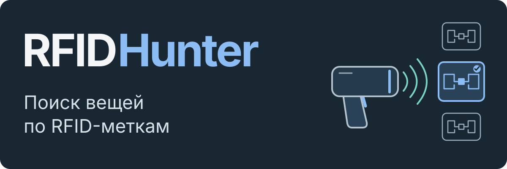

<p align="center"><a href="README.md">English</a> · <strong>Русский</strong></p>

<h1></h1>

Android-приложение для **поиска вещей с RFID-метками** через **внешний считыватель
Honeywell IH25**, подключённый по Bluetooth. Вещь можно выбрать голосом или из
фотокаталога, затем искать её по шкале сигнала и звуковым щелчкам, перемещая считыватель.

Интерфейс рассчитан на пожилых людей и пользователей со сниженным зрением или
точностью движений: крупные фотографии и кнопки, устойчивый к дрожанию ввод,
физические клавиши и звуковая обратная связь помогают выполнять основные действия.

[Как работает](#как-работает) · [Запуск без считывателя](#запуск-без-считывателя) · [Инженерные решения](#инженерные-решения)

## Как работает

1. **Добавление вещи.** На вещь крепится метка, затем сохраняются русское название,
   фотография и код метки в локальном каталоге.
2. **Выбор для поиска.** Вещь выбирается командой `найди очки` или из фотокаталога.
3. **Поиск по сигналу.** Удержание курка считывателя запускает поиск. Шкала и
   учащающиеся щелчки указывают на усиление сигнала при перемещении считывателя;
   отпускание курка ставит поиск на паузу.

Шкала показывает уровень сигнала, а не расстояние. Короткое нажатие курка проверяет
близкие метки. Если удалось уверенно выбрать одну, новая метка запускает добавление
вещи, а известная открывает её карточку. При неоднозначном чтении приложение
спрашивает, что найти.
Кнопки громкости делают снимок или листают каталог. Полные сценарии описаны в
[руководстве пользователя](docs/USAGE.RU.md).

## Инженерные решения

- **Выбор метки среди соседних.** Алгоритм сохраняет максимальный уровень сигнала
  (RSSI) для каждой метки и сравнивает лидеров. Если выбор неоднозначен,
  приложение переходит к голосовому запросу.
  [Алгоритм выбора](app/src/main/kotlin/ru/rfidhunter/app/domain/RfidDecisionEngine.kt)
- **Локальное распознавание речи.** Адаптивный детектор учитывает шумовой фон
  и сохраняет звук вокруг границ фразы. Vosk распознаёт русские команды без сети;
  диагностические записи можно повторно распознать и исследовать.
  [Устройство аудиотракта](ARCHITECTURE.RU.md#audio-pipeline)
- **Очередь изменений для резервирования.** Изменение каталога и событие очереди
  сохраняются одной транзакцией Room. WorkManager повторяет отправку, а необязательный
  сервер применяет события идемпотентно и восстанавливает каталог и фотографии на
  другом телефоне. Запросы подписываются ключом устройства.
  [Протокол резервирования](BACKUP_SYNC.md)

Поиск, фотографии и каталог работают локально.
[Сервер резервирования](server/README.RU.md) разворачивается отдельно по желанию.

## Запуск без считывателя

Нужны JDK 17 и Android SDK Platform 35. Gradle Wrapper загружает Gradle 8.9. Команда из корня репозитория:

```bash
bash ./gradlew :app:assembleMockDebug
```

В PowerShell: `.\gradlew.bat :app:assembleMockDebug`.

Файл `app-mock-debug.apk` из `app/build/outputs/apk/mock/debug/` устанавливается
на Android 9 или новее. Вариант mock использует тестовый считыватель и отдельный
идентификатор приложения. На его главном экране кнопка **`Разработчик: сервис`**
открывает сценарии чтения меток и поле для текстовых русских команд. Для знакомства
с этими сценариями не нужны считыватель, Honeywell SDK или речевая модель.

**Интерфейс приложения и голосовые команды — на русском.** Для распознавания речи
отдельно подключается модель Vosk; записанные подсказки тоже добавляются отдельно.
[Руководство разработчика](docs/DEVELOPMENT.RU.md) описывает маршрут mock,
аппаратную сборку, модели и диагностику, включая дополнительный движок Whisper.cpp.

## Проверки

```bash
bash ./gradlew :app:testMockDebugUnitTest
python3 scripts/test_vad_reference.py
cd server
uv sync --dev
uv run pytest
```

Наборы тестов проверяют выбор RFID-метки, команды и правила взаимодействия; синтетические аудиосценарии Python-детектора; серверный API резервирования, включая подписи, повторы, конфликты и восстановление. Результаты с датой запуска и условия сборки приведены в [руководстве разработчика](docs/DEVELOPMENT.RU.md#verification).

## Документация

- [Архитектура и обработка звука](ARCHITECTURE.RU.md)
- [Сборка, mock-сценарии, модели и проверки на устройстве](docs/DEVELOPMENT.RU.md)
- [Пользовательские сценарии](docs/USAGE.RU.md)
- [Сервер резервирования](server/README.RU.md) и [протокол синхронизации](BACKUP_SYNC.md)
- [Передача аппаратной реализации](RFID_IMPLEMENTATION_HANDOFF.md)
- [Историческая UI-ревизия](UI_REVIEW.md)
