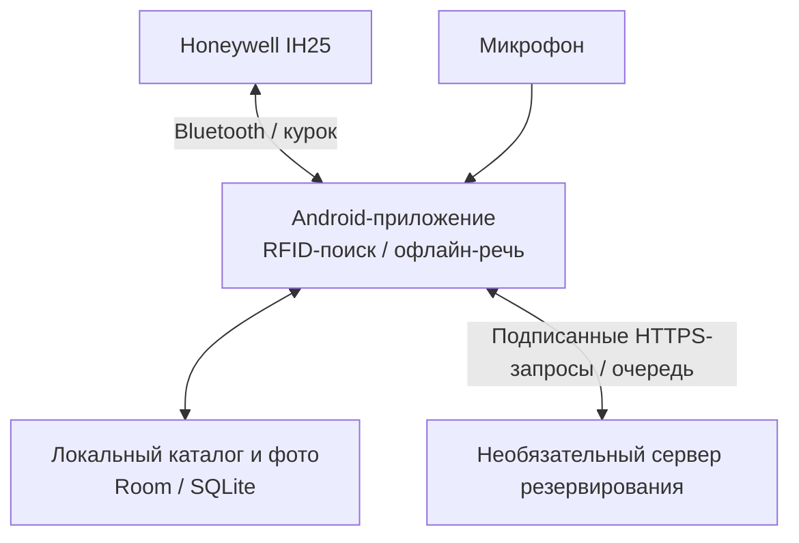

# RFIDHunter — поиск вещей с RFID-метками

[English version](README.md)

RFIDHunter — офлайн-приложение для Android, которое помогает находить вещи со считывателем Honeywell IH25. У каждой вещи есть название, произнесённое по-русски, фотография и код RFID-метки. Пользователь выбирает вещь голосом или из каталога, затем перемещает считыватель, ориентируясь на шкалу сигнала и учащающиеся щелчки.

Приложение рассчитано на пожилых людей и пользователей со сниженным зрением или точностью движений. Основные действия доступны через крупные элементы, записанные голосовые подсказки, устойчивый к дрожанию ввод и физические кнопки. Поиск, фотографии и каталог работают локально; необязательный сервер резервирования позволяет восстановить каталог на другом телефоне.



## Как работает

Короткое нажатие курка проверяет близкие метки на малой мощности. Сильная близкая неизвестная метка запускает добавление вещи, известная — открывает её карточку. Если подходящую метку выбрать нельзя, приложение спрашивает, что найти. Удержание курка на экране поиска запускает чтение выбранной метки, отпускание ставит поиск на паузу. Кнопки громкости делают снимок или листают каталог в зависимости от экрана.

## Инженерные решения

- **Выбор близкой метки по уровню сигнала.** Алгоритм объединяет повторные чтения по коду метки, сохраняет лучший RSSI и сравнивает лидирующих кандидатов. Явная близкая метка определяет следующее действие; неоднозначное чтение переводит к голосовому запросу. [Алгоритм выбора](app/src/main/kotlin/ru/rfidhunter/app/domain/RfidDecisionEngine.kt)
- **Сохранение полной фразы.** Адаптивный детектор речи оценивает шумовой фон микрофона, использует разные пороги начала и продолжения речи, сохраняет звук до и после найденной фразы. Исходные диагностические WAV можно повторно распознать и исследовать в Python. Основной распознаватель Vosk работает локально; Whisper.cpp включается вручную для диагностики. [Устройство аудиотракта](ARCHITECTURE.RU.md#audio-pipeline)
- **Сохранение изменений до отправки.** Изменение каталога и событие для резервирования записываются одной транзакцией базы данных. WorkManager повторяет отправку, сервер применяет операции идемпотентно, фотографии адресуются по SHA-256. Ключ устройства подписывает запросы через ECDSA; восстановление учётной записи регистрирует новый телефон и отзывает прежние ключи. [Протокол резервирования](BACKUP_SYNC.md)

## Запуск без считывателя

Нужны JDK 17 и Android SDK Platform 35. Gradle Wrapper загружает Gradle 8.9. Команда из корня репозитория:

```bash
bash ./gradlew :app:assembleMockDebug
```

В PowerShell: `.\gradlew.bat :app:assembleMockDebug`.

Файл `app/build/outputs/apk/mock/debug/app-mock-debug.apk` устанавливается на Android 9 или новее. Вариант mock использует тестовый считыватель и отдельный идентификатор приложения. Сервисный экран открывается пятью нажатиями `Громкость−` с удержанием пятого около 800 мс. На нём доступны сценарии чтения меток и текстовое поле для русских команд: считыватель и речевая модель для знакомства со сценариями не нужны. [Маршрут mock и настройка оборудования](docs/DEVELOPMENT.RU.md)

## Проверки

```bash
bash ./gradlew :app:testMockDebugUnitTest
python3 scripts/test_vad_reference.py
cd server
uv sync --dev
uv run pytest
```

Наборы тестов проверяют выбор RFID-метки, команды и правила взаимодействия; синтетические аудиосценарии Python-детектора; серверный API резервирования, включая подписи, повторы, конфликты и восстановление. Результаты с датой запуска и условия сборки приведены в [руководстве разработчика](docs/DEVELOPMENT.RU.md#verification).

## Документация

- [Архитектура и обработка звука](ARCHITECTURE.RU.md)
- [Сборка, mock-сценарии, модели и проверки на устройстве](docs/DEVELOPMENT.RU.md)
- [Пользовательские сценарии](docs/USAGE.RU.md)
- [Сервер резервирования](server/README.RU.md) и [протокол синхронизации](BACKUP_SYNC.md)
- [Передача аппаратной реализации](RFID_IMPLEMENTATION_HANDOFF.md)
- [Историческая UI-ревизия](UI_REVIEW.md)
