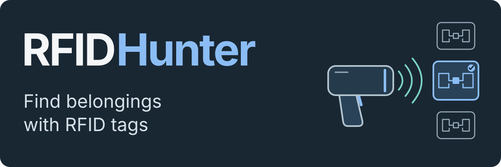

<p align="center"><strong>English</strong> · <a href="README.RU.md">Русский</a></p>

<h1></h1>

An Android app for **finding tagged belongings** with an **external Honeywell
IH25 RFID reader** connected over Bluetooth. Choose an item by voice or from the
photo catalog, then follow the signal display and clicks while moving the reader.

The interface is designed for older people and users with limited vision or motor
control: large photos and buttons, forgiving touch handling, physical keys and
audio feedback support the main tasks.

[How it works](#how-it-works) · [Try without a reader](#try-without-a-reader) · [Engineering decisions](#engineering-decisions)

## How it works

1. **Register the item.** Attach a tag, give the item a Russian name and take a photo.
   The app saves the name, photo and tag ID in its local catalog.
2. **Choose what to find.** Say `найди очки` (find my glasses), or choose the item
   from the photo catalog.
3. **Follow the signal.** Hold the reader's trigger and move it around. The signal
   meter and more frequent clicks indicate a stronger response; releasing the
   trigger pauses the search.

The meter indicates signal strength, not distance. A short trigger press checks
nearby tags: a clear unknown tag starts registration, a known tag opens its card,
and an inconclusive reading starts a voice request. Volume keys take a photo or
navigate the catalog. The [user guide](docs/USAGE.md) covers the full workflows.

## Engineering decisions

- **Choose a tag among nearby candidates.** Readings are grouped by tag ID;
  the strongest received signal (RSSI) and the gap between leading tags determine the next action.
  Ambiguous input leads to a voice request. [Decision engine](app/src/main/kotlin/ru/rfidhunter/app/domain/RfidDecisionEngine.kt)
- **Recognize speech locally.** An adaptive voice activity detector follows the
  noise floor and retains audio around the phrase boundaries. Vosk recognizes
  Russian commands offline; diagnostic recordings can be replayed and inspected.
  [Audio architecture](ARCHITECTURE.md#audio-pipeline)
- **Keep catalog changes ready for backup.** A catalog change and its queued event
  are saved in one Room transaction. WorkManager retries delivery; the optional
  server applies events idempotently and supports restoring the catalog and photos
  on another phone. Requests are signed with a device key.
  [Backup protocol](BACKUP_SYNC.md)

Search, photos and the catalog work locally. The
[backup server](server/README.md) is an optional component to deploy separately.

## Try without a reader

Requires JDK 17 and Android SDK Platform 35. The Gradle wrapper downloads Gradle 8.9. From the repository root:

```bash
bash ./gradlew :app:assembleMockDebug
```

PowerShell: `.\gradlew.bat :app:assembleMockDebug`.

Install `app-mock-debug.apk` from `app/build/outputs/apk/mock/debug/` on Android 9
or later. The mock flavor uses a simulated reader and a separate application ID.
On its home screen, open **`Разработчик: сервис`** to select tag scenarios and
enter Russian commands as text. Exploring these workflows needs no reader,
Honeywell SDK or speech model.

**The app UI and voice commands are Russian.** Voice recognition requires a
separately supplied Vosk model; recorded prompts are also supplied separately.
The [development guide](docs/DEVELOPMENT.md) covers the mock walkthrough,
hardware build, models and diagnostics, including the optional Whisper.cpp backend.

## Checks

```bash
bash ./gradlew :app:testMockDebugUnitTest
python3 scripts/test_vad_reference.py
cd server
uv sync --dev
uv run pytest
```

The suites cover RFID decisions, commands and interaction policies; synthetic audio cases for the Python detector; and backup API behavior including signatures, retries, conflicts and recovery. Dated results and build prerequisites are recorded in the [development guide](docs/DEVELOPMENT.md#verification).

## Documentation

- [Architecture and audio processing](ARCHITECTURE.md)
- [Build, mock scenarios, models and device checks](docs/DEVELOPMENT.md)
- [User workflows](docs/USAGE.md)
- [Backup server](server/README.md) and [sync protocol](BACKUP_SYNC.md)
- [Hardware implementation handoff](RFID_IMPLEMENTATION_HANDOFF.md)
- [Historical UI review](UI_REVIEW.md)
