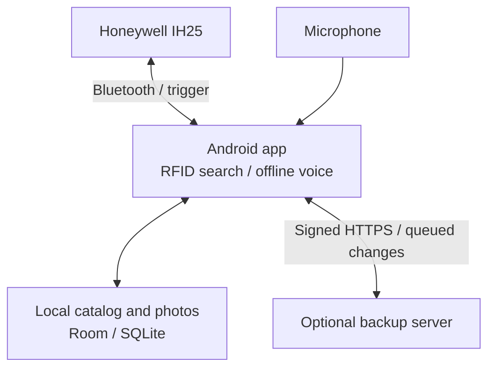

# RFIDHunter — find belongings with RFID

[Русская версия](README.RU.md)

RFIDHunter is an offline Android app for finding tagged belongings with a Honeywell IH25 RFID reader. Each item has a spoken Russian name, a photo and a tag ID. The user chooses an item by voice or from the catalog, then follows the signal display and accelerating clicks while moving the reader.

The app is designed for older people and users with limited vision or motor control: large controls, recorded voice prompts, forgiving touch handling and physical buttons keep the main tasks accessible. Search, photos and the catalog work locally; an optional backup server restores the catalog on a replacement phone.



## How it works

A short trigger press checks nearby tags at low power. A strong nearby unknown tag starts item registration; a known tag opens its item card. When no clear tag is nearby, the app asks what to find. Holding the trigger on the search screen reads the selected tag; releasing it pauses the search. Volume buttons take a photo or navigate the catalog, depending on the screen.

## Engineering decisions

- **Choose a nearby tag by signal strength.** The decision engine groups repeated reads by tag ID, keeps the strongest signal (RSSI) and compares the leading candidates. A clear nearby tag selects the next action; ambiguous readings lead to a voice request. [Decision engine](app/src/main/kotlin/ru/rfidhunter/app/domain/RfidDecisionEngine.kt)
- **Capture a complete phrase.** An adaptive voice activity detector tracks the microphone noise floor, uses separate start and continuation thresholds, and keeps audio around the detected phrase. Raw diagnostic WAV files let the recording be replayed and inspected with Python. Recognition runs locally through Vosk; Whisper.cpp is a manually selected diagnostic engine. [Audio architecture](ARCHITECTURE.md#audio-pipeline)
- **Save changes before sending them.** A catalog change and its pending backup event are stored in one database transaction. WorkManager retries delivery, the server applies operations idempotently, and photos are addressed by SHA-256. Device keys sign requests with ECDSA; account recovery registers the replacement phone and revokes previous keys. [Backup protocol](BACKUP_SYNC.md)

## Try without a reader

Requires JDK 17 and Android SDK Platform 35. The Gradle wrapper downloads Gradle 8.9. From the repository root:

```bash
bash ./gradlew :app:assembleMockDebug
```

PowerShell: `.\gradlew.bat :app:assembleMockDebug`.

Install `app/build/outputs/apk/mock/debug/app-mock-debug.apk` on Android 9 or later. The mock flavor uses a simulated reader and a separate application ID. Open the service screen with five presses of Volume Down, holding the fifth for about 800 ms. It offers tag scenarios and a text field for Russian commands, so no reader or speech model is needed to inspect the workflow. [Mock walkthrough and hardware setup](docs/DEVELOPMENT.md)

## Checks

```bash
bash ./gradlew :app:testMockDebugUnitTest
python3 scripts/test_vad_reference.py
cd server
uv sync --dev
uv run pytest
```

The suites cover RFID decisions, commands and interaction policies; synthetic audio cases for the Python detector; and backup API behavior including signatures, retries, conflicts and recovery. Dated results and build prerequisites are recorded in the [development guide](docs/DEVELOPMENT.md#verification).

## Documentation

- [Architecture and audio processing](ARCHITECTURE.md)
- [Build, mock scenarios, models and device checks](docs/DEVELOPMENT.md)
- [User workflows](docs/USAGE.md)
- [Backup server](server/README.md) and [sync protocol](BACKUP_SYNC.md)
- [Hardware implementation handoff](RFID_IMPLEMENTATION_HANDOFF.md)
- [Historical UI review](UI_REVIEW.md)
